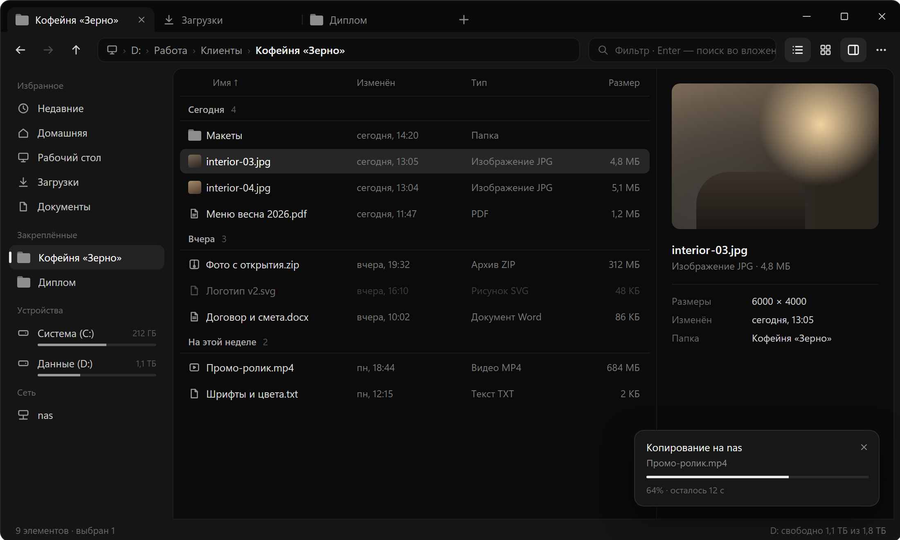

<div align="center">


# Files

**Чёрно-белый файловый менеджер для Windows 11 на Rust**

Быстрее Проводника: папка на 5 тысяч файлов открывается за 25 мс. Вкладки, предпросмотр, свой прогресс копирования с отменой, Ctrl+Z и ZIP как обычные папки.

[](https://github.com/trualontuu/files/releases/latest/download/Files.zip)


[](https://github.com/trualontuu/files/releases/latest)



<sub>Макет: папки и файлы выдуманные.</sub>

</div>

## Установка

> Нужна Windows 11 (64-бит). Движок WebView2 в Windows 11 уже есть, ставить ничего не нужно.

1. Скачай **[Files.zip](https://github.com/trualontuu/files/releases/latest/download/Files.zip)** и распакуй, например, в `%LOCALAPPDATA%\Programs\Files`.
2. Запусти `Files.exe`. Это один файл, весит около 1 МБ.
3. Если хочешь, чтобы папки и <kbd>Win</kbd>+<kbd>E</kbd> открывались в Files, а не в Проводнике, включи это в меню **«⋯» → «Открывать папки в Files»**. Выключается там же.

<details>
<summary><b>Windows пишет «Windows защитила ваш компьютер»</b></summary>

Программа не подписана платным сертификатом. Нажми **«Подробнее» → «Выполнить в любом случае»**. Окно появляется только при первом запуске.
</details>

<details>
<summary><b>Не сломает ли это Проводник</b></summary>

Нет. Files ничего не заменяет в системе. Опция «Открывать папки в Files» добавляет пару ключей в реестр текущего пользователя (`HKCU`), а при выключении удаляет их. Корзину, «Этот компьютер», телефон и другие системные места Files по-прежнему открывает в Проводнике. Команда «Открыть в Проводнике» есть в меню любой папки.
</details>

<details>
<summary><b>Как удалить</b></summary>

Если включал «Открывать папки в Files», сначала выключи эту опцию. Потом закрой Files и удали папку с `Files.exe`. Вкладки и настройки лежат в `%LOCALAPPDATA%\Files`, эту папку тоже можно удалить.
</details>

## Что умеет

| | |
|---|---|
| ⚡ **Быстрый** | папка на 5 тысяч файлов открывается за 25 мс, а на 19 тысяч — меньше чем за 0,1 с со второго раза; список виртуальный, поэтому прокрутка плавная на любом объёме |
| 🗂 **Вкладки и два окна** | вкладки сохраняются между запусками; <kbd>Ctrl</kbd>+<kbd>N</kbd> открывает новое окно, «Два окна рядом» раскладывает их по половинам экрана |
| 👁 **Предпросмотр** | фото (с учётом поворота из EXIF), видео, PDF, текст и код, содержимое архивов, размер папок |
| 📦 **ZIP как папка** | в архив можно зайти, открыть или скопировать из него файл, вытащить его мышкой; кроме того, «Извлечь», «Извлечь в папку» и «Сжать в ZIP» |
| ↩️ **Ctrl+Z** | отменяет копирование, перемещение, переименование и удаление (возвращает файлы из Корзины); <kbd>Ctrl</kbd>+<kbd>Y</kbd> повторяет |
| 📊 **Свой прогресс** | карточка с полосой, текущим файлом и оставшимся временем; кнопка отмены останавливает копирование сразу и убирает недокопированный файл |
| 🖱 **Перетаскивание** | файлы перетаскиваются в Проводник, Telegram, браузер и обратно; работает и буфер обмена, общий с Проводником |
| 🔎 **Поиск** | фильтр текущей папки на лету, а по <kbd>Enter</kbd> — поиск во всех вложенных папках, результаты появляются по мере нахождения |
| 🕘 **Недавние, группы, столбцы** | недавние файлы, группировка по дате или типу, выбор столбцов правым щелчком по заголовку |
| 🌐 **Сеть** | общие папки компьютеров в сети: `\\nas` в адресной строке или «Подключиться…» на боковой панели |

### Клавиши

| | |
|---|---|
| <kbd>Ctrl</kbd>+<kbd>T</kbd> · <kbd>Ctrl</kbd>+<kbd>W</kbd> | новая / закрыть вкладку |
| <kbd>Ctrl</kbd>+<kbd>N</kbd> | новое окно |
| <kbd>Ctrl</kbd>+<kbd>K</kbd> | все команды |
| <kbd>Ctrl</kbd>+<kbd>L</kbd> | адресная строка |
| <kbd>Ctrl</kbd>+<kbd>F</kbd> | фильтр и поиск |
| <kbd>Ctrl</kbd>+<kbd>Z</kbd> · <kbd>Ctrl</kbd>+<kbd>Y</kbd> | отменить / повторить |
| <kbd>F2</kbd> · <kbd>Del</kbd> · <kbd>Shift</kbd>+<kbd>Del</kbd> | переименовать / в Корзину / удалить совсем |
| <kbd>Ctrl</kbd>+<kbd>Shift</kbd>+<kbd>N</kbd> | новая папка |
| <kbd>Пробел</kbd> | панель предпросмотра |
| <kbd>Ctrl</kbd>+<kbd>H</kbd> | скрытые файлы |
| <kbd>Alt</kbd>+<kbd>←</kbd> · <kbd>Alt</kbd>+<kbd>↑</kbd> | назад / на уровень выше |

## Для разработчиков

<details>
<summary><b>Сборка из исходников</b></summary>

Нужны [Rust](https://rustup.rs) и Visual Studio Build Tools (C++).

```
git clone https://github.com/trualontuu/files
cd files
cargo build --release
```

Готовый файл — `target\release\files.exe`. Интерфейс (`ui/ui.html`) вшит в exe.

Устройство: окно на Win32 со своей рамкой, WebView2 через COM напрямую (`webview2-com`, без wry/tauri). Список папок и поиск идут через `std::fs` в фоновых потоках. Миниатюры фото декодирует WIC, видео и PDF берутся из оболочки Windows, всё это в пуле из трёх потоков. Операции с файлами выполняются через `IFileOperation` со своим `IFileOperationProgressSink`, отсюда прогресс, отмена и точные пути для Ctrl+Z. Перетаскивание наружу — `SHDoDragDrop`, контекстное меню — системное `IContextMenu`, за изменениями в папке следит `notify`.

Тестовый запуск, не мешающий основному: `FILES_TEST=1` (окно за пределами экрана), `FILES_DATA=<папка>` (отдельные данные), `FILES_OPEN=<путь>`, `FILES_SNAP=<файл.png>` (снимок окна и выход).
</details>
